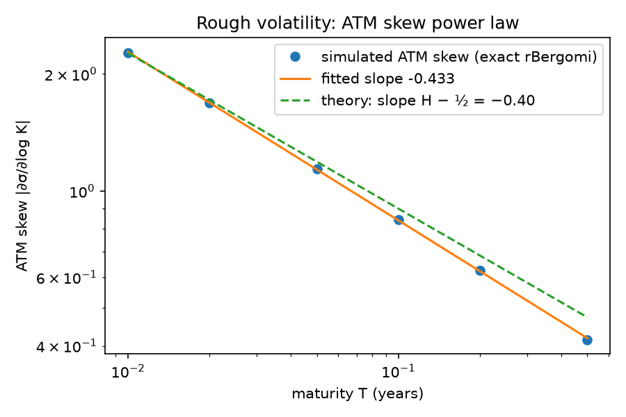
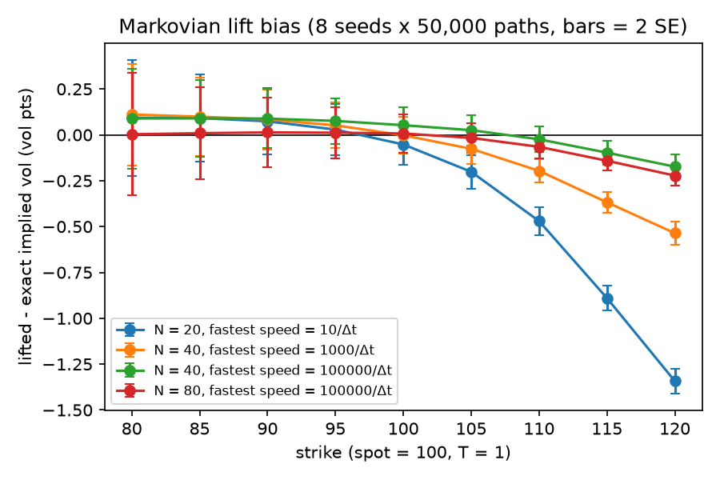
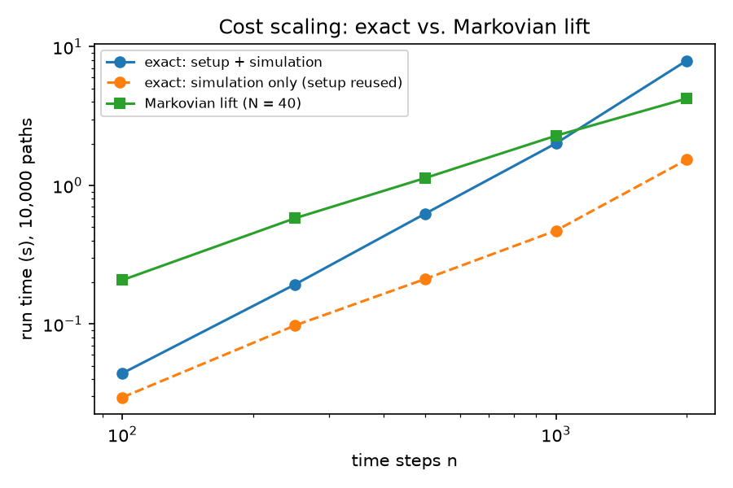

# rough_pricer

Monte Carlo option pricing under rough volatility (rough Bergomi, H = 0.1). Compares Cholesky-based simulation, which samples the rough volatility driver exactly on the time grid, against a Markovian multi-factor approximation, with tests and benchmarks.



The simulated ATM skew closely follows the rough-volatility power law: fitted slope -0.433 vs. the leading-order theory value H - 1/2 = -0.40. The small gap comes from higher-order vol-of-vol effects, which grow with maturity.



Extending the lift's fastest factor speed cut its worst-case implied-vol bias from about 1.3 to about 0.2 vol pts (T = 1, 8 seeds x 50,000 paths). A small right-wing bias remains, and adding factors beyond 40 does not remove it.



The lift's cost grows linearly with the number of time steps. Counting the exact method's one-time setup, the lift is faster beyond ~1,000 steps; if that setup is reused, exact simulation stays faster at the sizes tested. At 2,000 steps the lift stores ~100x less data (3.3 MB vs. 320 MB).

```bash
pip install -r requirements.txt
python3 -m pytest                      # 9 tests
python3 -m experiments.lift_bias       # also: skew_powerlaw, benchmark
```

Based on Bayer, Friz & Gatheral (2016), *Pricing under rough volatility*, and Abi Jaber & El Euch (2019), *Multifactor approximation of rough volatility models*.
